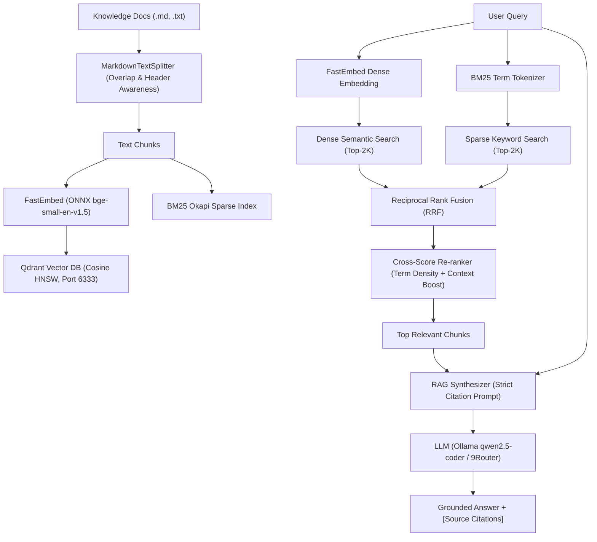

# Enterprise Hybrid RAG System

Sistem **Retrieval-Augmented Generation (RAG) Tingkat Enterprise** yang mengimplementasikan standar kurikulum [roadmap.sh/ai-engineer](https://roadmap.sh/ai-engineer).

## Arsitektur Pipeline



## Fitur Utama

1. **Vector Database:** **Qdrant** (high-performance Rust vector engine) running in Docker with persistent storage and Web Dashboard at `http://localhost:6333/dashboard`.
2. **Dense Semantic Embeddings:** Menggunakan `FastEmbed` dengan runtime ONNX lokal (`BAAI/bge-small-en-v1.5`, vector dimension: 384) yang sangat cepat (<10ms) tanpa dependensi berat PyTorch CUDA.
3. **Sparse Keyword Search:** Menggunakan algoritma **BM25 Okapi** untuk pencocokan kata kunci eksak (nama server, kode error, IP address, istilah spesifik).
4. **Hybrid Search & Fusion:** Menggabungkan skor dense dan sparse menggunakan **Reciprocal Rank Fusion (RRF)** ($k=60$).
5. **Re-Ranking:** Re-ranker untuk memprioritaskan dokumen yang memiliki densitas istilah query tertinggi dan kesesuaian judul konteks.
6. **Grounding & Citations:** LLM synthesizer yang mewajibkan sitasi inline `[Source: document_name, Chunk ID]` dan menolak halusinasi jika data tidak ada di basis pengetahuan.

---

## Panduan Penggunaan CLI

### 1. Menjalankan Vector DB (Qdrant)
```bash
docker compose up -d
```
Akses dashboard visual di browser: `http://localhost:6333/dashboard`

### 2. Cek Status Koleksi Vektor
```bash
python3 -m src.rag.cli status
```

### 3. Ingestion Dokumen
```bash
python3 -m src.rag.cli ingest --path ./docs/knowledge_base
```

### 4. Uji Coba Hybrid Search (Inspeksi Ranking)
```bash
python3 -m src.rag.cli search "kapan penarikan dana tripay hari sabtu bisa cair"
```

### 5. Pertanyaan RAG Lengkap dengan Sitasi (End-to-End)
```bash
LLM_MODEL="qwen2.5-coder:3b" LLM_BASE_URL="http://localhost:11434/v1" python3 -m src.rag.cli ask "kapan dana qris tripay sabtu bisa ditarik dan berapa minimalnya"
```

### 6. Menjalankan Unit Tests
```bash
python3 -m unittest tests/test_rag.py
```
